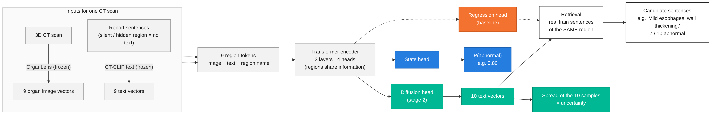

# Full pipeline: from one silent region to P(abnormal), sentences and uncertainty



Example: one test scan. The radiologist wrote about the heart, lung and other regions,
but wrote **nothing about the esophagus** (silent / hidden).

```
                              ENCODER  (stage 1, frozen in stage 2)
        (understands the esophagus from its own image + the other regions' image and text)
                                   │
                ┌──────────────────┴──────────────────┐
                ▼                                     ▼
          STATE HEAD                            DIFFUSION HEAD  (stage 2)
   "is this region abnormal?"             "what would the radiologist write?"
                │                                     │
      P(abnormal) = 0.80                  10 samples → 10 text vectors
                                                      │ retrieval (train sentences only)
                                                      ▼
                                       sentence 1: "Mild esophageal wall thickening."  (abnormal)
                                       sentence 2: "Mild esophageal wall thickening."  (abnormal)
                                       sentence 3: "Esophagus is normal in calibre."   (normal)
                                       sentence 4: "Small hiatal hernia."              (abnormal)
                                       ...
                                       → 7 / 10 sentences abnormal
                                       → spread between samples = uncertainty
```

## What each part gives

| Part | Output | Example | Trained for |
|---|---|---|---|
| **State head** | one number, P(abnormal) | "80% likely abnormal" | detecting abnormality (binary cross-entropy) |
| **Diffusion head** | 10 possible text vectors → 10 real sentences | "Mild esophageal wall thickening." | modelling what could be written (denoising loss) |
| Diffusion, counted | indirect P(abnormal) | 7 / 10 abnormal sentences → 0.70 | (follows from the sentences) |
| Diffusion, spread | uncertainty | samples disagree a lot → model is unsure | (follows from the samples) |

- The **state head** is the best abnormality detector (it is trained only for that).
- The **diffusion head** writes the sentences and says how sure the model is. It does not replace the state head.
- Analogy: the state head is the specialist who answers "disease or not"; the diffusion head is the
  report writer. You can guess the answer from the report, but the specialist is more accurate.

## Two training stages

```
stage 1 (train.py)            tokens → encoder → state head + regression head
                              loss = cosine (vector) + binary cross-entropy (state), hidden regions only
                              → runs/regression_none_state/best.pt

stage 2 (train_diffusion.py)  stage-1 model FROZEN → encoded tokens → diffusion head
                              loss = MSE between predicted and true clean vector (DALL·E 2 prior style)
                              → runs/diffusion_none_state/diffusion_head.pt
```

## Test results (RadGenome valid split, 1,564 scans, leave-one-region-out)

| Method | Heart AUC | Esophagus AUC | Macro AUC (9 regions) |
|---|---|---|---|
| silence = normal (baseline) | 0.500 | 0.500 | 0.500 |
| regression head → sentence | 0.759 | 0.543 | 0.633 |
| **diffusion head → sentences** | **0.812** | **0.763** | **0.723** |
| **state head** | **0.862** | **0.791** | **0.788** |

Mean sample spread (uncertainty) is higher for abnormal than for normal regions
(esophagus 0.117 vs 0.080, heart 0.250 vs 0.227).
